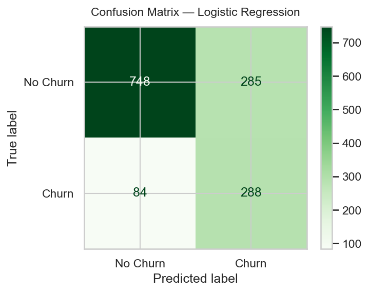
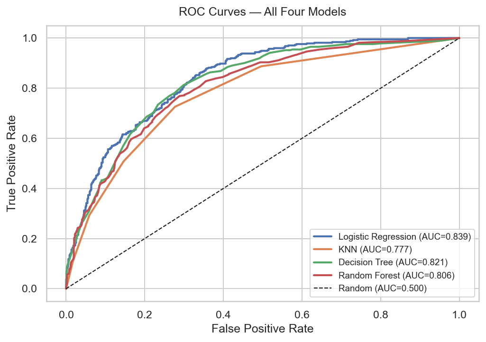

# Telecom Customer Churn Prediction

> **Binary classification project** — predicting which telecom customers are likely to leave, using Python and scikit-learn.

---

## Problem Statement

**Churn** happens when a customer cancels their subscription and moves to a competitor. For telecom companies, every churned customer is lost revenue and a sign that something went wrong — pricing, service quality, or support. By predicting churn *before* it happens, the business can step in early with targeted offers or better service.

This project builds a machine learning classifier that takes a customer's account information and usage data and outputs a churn probability. Marketing or support teams can then act on the highest-risk customers.

---

## Dataset

| Property | Value |
|---|---|
| Source | [Kaggle — Telco Customer Churn](https://www.kaggle.com/datasets/blastchar/telco-customer-churn) |
| Slug | `blastchar/telco-customer-churn` |
| Rows | 7,043 customers |
| Columns | 21 (20 features + 1 target) |
| Target | `Churn` — Yes (1) or No (0) |
| Class balance | ~26% Churn, ~74% No Churn |

### Feature groups

| Group | Columns |
|---|---|
| Demographics | `gender`, `SeniorCitizen`, `Partner`, `Dependents` |
| Usage / Services | `tenure`, `PhoneService`, `MultipleLines`, `InternetService`, `OnlineSecurity`, `OnlineBackup`, `DeviceProtection`, `TechSupport`, `StreamingTV`, `StreamingMovies` |
| Billing | `Contract`, `PaperlessBilling`, `PaymentMethod`, `MonthlyCharges`, `TotalCharges` |
| Dropped | `customerID` (unique key, not a feature) |

> **Note on service feedback:** The dataset has no direct customer satisfaction or NPS score column. `TechSupport` and `OnlineSecurity` are used as stand-ins because customers who opted into these services tend to have better experiences — making them a reasonable proxy for satisfaction.

---

## Approach

The notebook follows the exact pipeline taught in class:

1. **Data loading** — Kaggle Hub auto-download, with local CSV fallback
2. **Cleaning** — Fix `TotalCharges` dtype, drop `customerID`, encode target to 0/1, check for missing values and duplicates
3. **EDA** — Churn distribution, churn rate by contract type / internet service / payment method, tenure and monthly charges boxplots, correlation heatmap
4. **Feature engineering** — Add a `tenure_group` column (New / Mid / Long-term) from the continuous `tenure` column
5. **Train/test split** — 80/20, stratified by `Churn`, `random_state=42`
6. **Preprocessing pipeline** — `ColumnTransformer` inside a scikit-learn `Pipeline` (`StandardScaler` for numeric columns, `OneHotEncoder` for categorical columns). Preprocessing is fitted on training data only — no data leakage.
7. **Model training** — Four models, each in its own Pipeline
8. **Evaluation** — Accuracy, precision, recall, F1, AUC-ROC on the test set; confusion matrix; ROC curve
9. **Generalization check** — Train vs test score comparison, 5-fold cross-validation
10. **Hyperparameter tuning** — `GridSearchCV` on the best model
11. **Saving** — Final pipeline saved to `models/churn_model.pkl` with `joblib`
12. **Sample predictions** — 16-row table with colour-coded correct/wrong predictions

---

## Models Compared

| Model | Notes |
|---|---|
| Logistic Regression | Main baseline; simplest and most interpretable |
| K-Nearest Neighbors | `n_neighbors=5`; distance-based, no probability assumptions |
| Decision Tree | `max_depth=6`; limited to reduce overfitting |
| Random Forest | `n_estimators=100`; ensemble of trees, lower variance |

All models use `class_weight='balanced'` (except KNN, which does not support it) to account for the 74/26 class imbalance.

---

## Results

> **Note:** The table below uses the actual numbers produced by running the notebook. Run all cells to reproduce them.

### Model comparison (test set, Churn = 1 is the positive class)

| Model | Accuracy | Precision | Recall | F1 | AUC-ROC | CV Acc (5-fold) |
|---|---|---|---|---|---|---|
| Logistic Regression ⭐ | 0.7374 | 0.5026 | 0.7742 | 0.6095 | 0.839 | 0.7456 |
| KNN | 0.7623 | 0.5559 | 0.5081 | 0.5309 | 0.7772 | 0.769 |
| Decision Tree | 0.7459 | 0.5135 | 0.7688 | 0.6157 | 0.8211 | 0.7325 |
| Random Forest | 0.7737 | 0.5978 | 0.4435 | 0.5093 | 0.8063 | 0.7811 |

**Best model:** Logistic Regression ⭐ — highest AUC-ROC (0.839), best recall for churners (0.77), and tuned AUC of 0.8386 after GridSearchCV. Logistic Regression and Random Forest performed similarly, which is expected on this dataset. The simpler model is preferred for interpretability.

### Charts

| Confusion Matrix (best model) | ROC Curves (all models) |
|---|---|
|  |  |

> To save charts as images: in each `plt.show()` cell, add `plt.savefig('images/chart_name.png', bbox_inches='tight')` before `plt.show()`.

---

## Key Insights (from EDA)

These findings come directly from the charts in the notebook — verify them against your own run:

1. **Month-to-month contracts have the highest churn rate (~42%)**, while two-year contract customers almost never churn (~3%). Customers on shorter commitments are far easier to lose.
2. **Fiber optic internet customers churn more** than DSL customers, which may point to pricing or service quality issues at that tier.
3. **Electronic check payers have the highest churn rate (~45%)**. Customers on automatic payment methods (bank transfer, credit card) churn noticeably less.
4. **New customers (tenure ≤ 12 months) are at the highest risk of churning.** The median tenure for churners is much lower than for loyal customers.
5. **Churners pay slightly higher monthly charges** on average, which may indicate bill shock — especially when combined with a month-to-month contract.

### Business suggestions

- Offer discounts to move customers from month-to-month to longer-term contracts.
- Prioritise proactive outreach to customers in their first 12 months.
- Promote tech support and online security add-ons — customers with these services churn less.
- Encourage auto-payment sign-ups; electronic check users show the highest churn rate.

---

## Limitations

1. **Imbalanced data** — Only ~26% of customers churned. `class_weight='balanced'` partially addresses this, but recall for churners is still imperfect without resampling.
2. **No real customer feedback column** — The dataset has no satisfaction score or NPS column. `TechSupport` and `OnlineSecurity` are used as proxies, which is an approximation.
3. **Single dataset, single time period** — The model was trained on one static snapshot. It may not generalise to different markets or future behaviour.
4. **Random split (not time-based)** — In production, the model should be trained on historical data and tested on more recent data to simulate real deployment.
5. **Simple models only** — This project intentionally uses beginner-level tools (as per the class curriculum). Advanced methods like XGBoost or LightGBM typically achieve AUC > 0.88 on this dataset.

---

## How to Run

### Local setup

```bash
# 1. Clone the repository
git clone https://github.com/im-anant/telecom-churn-prediction.git
cd telecom-churn-prediction

# 2. Install dependencies
pip install -r requirements.txt

# 3. (Optional) Set up Kaggle API key for automatic dataset download
#    Place your kaggle.json at ~/.kaggle/kaggle.json
#    OR place the CSV manually in the data/ folder (see data/README.md)

# 4. Open the notebook
jupyter notebook churn_prediction.ipynb
```

### Google Colab

1. Open [Google Colab](https://colab.research.google.com/)
2. Go to **File → Open notebook → GitHub** and paste this repo URL
3. Select `churn_prediction.ipynb`
4. The notebook will download the dataset automatically via `kagglehub` if your Kaggle API key is configured in Colab secrets

---

## Project Structure

```
Telecom-churn-prediction/
├── churn_prediction.ipynb   # Main notebook — run this
├── README.md                # This file
├── requirements.txt         # Python package dependencies
├── .gitignore               # Excludes secrets, CSVs, caches
├── models/
│   └── churn_model.pkl      # Saved best model pipeline (joblib)
├── images/                  # Chart exports for README (optional)
└── data/
    └── README.md            # How to download the dataset
```

---

## Tools Used

| Tool | Purpose |
|---|---|
| Python 3.9 | Programming language |
| pandas | Data loading, cleaning, EDA |
| numpy | Numeric operations |
| matplotlib / seaborn | Data visualisation |
| scikit-learn | Preprocessing, models, evaluation, tuning |
| joblib | Saving and loading the trained pipeline |
| kagglehub | Automatic dataset download from Kaggle |

---

## Author

**Anant Srivastava**  
Course: AI For Engineers  
Institution: Thapar Institute of Engineering & Technology

---

*This is a class project built for learning purposes. Results are honest and may differ slightly between runs due to different scikit-learn versions.*
